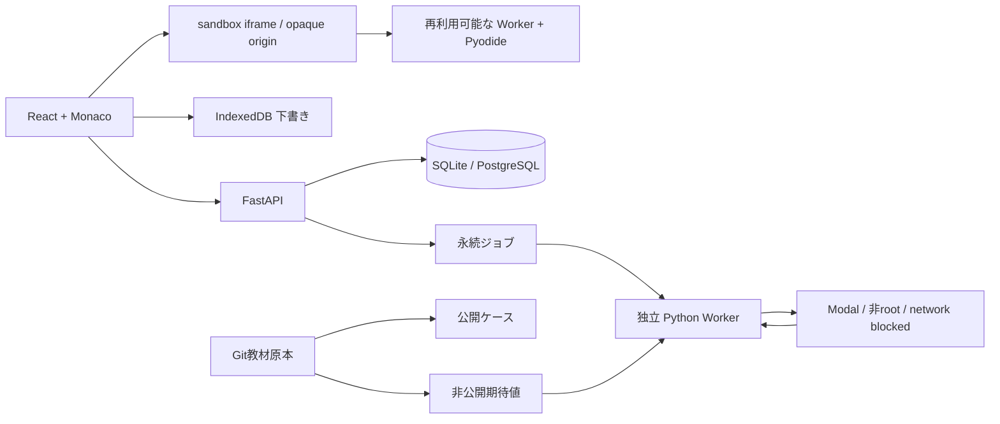

# アーキテクチャ

## フロントエンド

React Routerで画面を切り替え、TanStack QueryでAPI由来の教材・セッション・履歴・分析を管理します。Zustandは集中モード、分割幅、結果タブだけを永続化します。Monaco自身が編集モデル・Undo/Redoを持ちます。`useDraft`は編集中コードを消さず、ローカル保存とrevision付き同期を行います。

ローカルゲストはAPIのHttpOnly Cookieを利用し、SupabaseモードはPKCEのセッションからBearer tokenをAPIだけへ送信します。実行用iframeやWorkerに認証情報を渡しません。

実行はスナップショットのコードを捕捉し、実行ID・メッセージchannel・結果のコードを照合します。編集後の結果には古い結果であることを表示し、その実行を提出しません。サーバー側ではSHA-256をジョブと提出の間で照合します。

## ブラウザのPythonランタイム

ブラウザ実行のDrillに入ると `python-runtime.ts` が起動を始める。ページ内で隔離iframe、Worker、Pyodideを保持し、ケースに必要なパッケージだけ初回にロードする。実行用Pythonコードの取得もページ内で共有する。初期化、パッケージ、実行の状態は個別に扱う。

各テストケースは新しいPython名前空間で実行する。状態を変更できる操作を持つコードは実行後にWorkerを破棄する。再利用対象はASTで限定した基本Python・NumPy・Pandasの処理。ファイル操作、リフレクション、属性書き換え、未登録のAPIなどを使用する解答も実行でき、その実行の後にランタイムを交換する。中止、実行上限、Worker異常でも交換する。AST判定は再利用条件であり、認証やネットワークの境界はopaque-origin iframeとCSPが担う。

`playwright.runtime.config.ts` でWorker生成、Pyodide初期化、パッケージ、学習者コード、テストケース、比較処理、API、結果表示を採取できる。測定用の修正前プロファイルは旧ライフサイクルを再現する。

## 採点

ブラウザは公開ケースだけを実行し、結果は`browser_provisional`になります。クライアント側の結果は利用者が改変できるため、正式習得を証明しません。

正式実行ではWorkerが問題バージョンとseedからケースを取得し、**入力とコードだけ**をModalへ送ります。期待値と比較コードは信頼領域に残ります。ModalにはDB・Auth・サービス資格情報を渡しません。戻った値は信頼側でshapeやdtypeを含めて比較し、指定された場合はASTも検査します。AST検査だけを安全性の境界として使いません。

Jobの作成はAPI、取得・lease更新・実行は別プロセスです。queued/running/completed/failed/timed_out/cancelledを保存します。ユーザー当たりのactive jobは部分unique indexで1件に制限します。Sandboxは最大35秒で破棄され、実行コマンドの上限は30秒です。lease切れは失敗へ収束させます。

## 学習モデル

履歴は追記し、集計済み習熟度と分離します。ヒントなし・解答未閲覧の異なる2ファミリーでGuided→Partialへ進みます。Independentの2問にはserver_verifiedが必要です。異なるseedの正式正解を応用、間隔を空けた復習を定着として扱います。復習のアルゴリズム名はinterval-v1で保存し、将来の方式へ置換できます。

問題バージョンごとの提出数・正解数・正式正解も保存します。認定レベルと別に、難易度・実行回数・初見か再提出か・ヒント・正誤を使った信頼スコアを計算します。スコアだけで正式認定を付けることはありません。

Dailyは復習40%・新規40%・既習弱点20%を基準に不足分を補充します。未設定Sandboxの問題はDailyから除きます。Concept/CustomでPyTorchを選んだ場合は設定不足を表示します。出題数の上限は50です。

教材階層はModule→Concept→Family→Version→Variantです。180問の独立した問題IDと2つのseedを分けて数えています。seedを増やして問題数を水増ししません。
